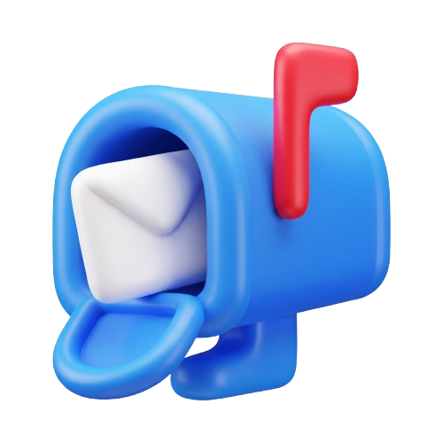

<div align="center">
  
  <h1>Mailclaw</h1>
  <p>
    <b>Email on your own domain, with Calendar, Drive, Booking and an AI assistant.</b><br />
    A self-hosted alternative to Google Workspace that runs on Cloudflare or in one Docker container.
  </p>
  <p>
    <a href="https://github.com/llypeDev/mailclaw/actions/workflows/checks.yml"></a>
    <a href="https://github.com/llypeDev/mailclaw/actions/workflows/e2e.yml"></a>
    <a href="LICENSE"></a>
    
    
    
  </p>
  <p>
    <a href="https://deploy.workers.cloudflare.com/?url=https://github.com/llypeDev/mailclaw">
      
    </a>
  </p>
  <p>
    <a href="#features">Features</a> ·
    <a href="#how-it-runs">How it runs</a> ·
    <a href="#cost">Cost</a> ·
    <a href="#get-started">Get started</a> ·
    <a href="#documentation">Documentation</a>
  </p>
</div>

---

## Features

Everything ships in the box. There is no paid tier, no license key and no account limit.

### Workspace

| App | What you get |
| --- | --- |
| **Email** | Mailboxes on your own domain, personal or shared, with aliases and per-person access. Conversation view, Gmail-style search, snooze, scheduled send and undo send, templates, follow-up reminders and optional read receipts. |
| **Calendar** | Repeating events with time zones, reminders, and email invitations for attendees. |
| **Booking** | A public link where anyone can book a free slot on your calendar. |
| **Drive** | Store files, share them with people or by link, and save attachments straight from mail. |
| **AI assistant** | Searches mail, drafts replies and manages events. Other AI tools can connect over MCP. |

### Mail handling

- **Routing rules** on each domain (store, forward, reject, catch-all) and in each mailbox (move to a folder, spam or trash).
- **Spam filtering** that combines sender authentication, content checks, your contacts and a learning filter, with optional Spamhaus and URLhaus lookups.
- **Webhooks** for new mail, with retries and a delivery log.
- **Import** from IMAP, Gmail Takeout, `.eml` and `.mbox`, running in the background. **Export** to `.mbox`.

### Accounts and security

- **Sign-in** with passwords, passkeys and authenticator-app codes (TOTP), with recovery codes and password reset by email.
- **Admin** pages for users, permissions, API keys, audit logs, branding and scheduled backups.
- **Mail apps** connect over JMAP, and iOS apps can get native push notifications.

The interface is translated into 34 languages, including three right-to-left ones.

<details>
<summary>All 34 languages</summary>

English, Português (Brasil), Português (Portugal), Español, Français, Deutsch, Italiano, Nederlands, Polski, Українська, Русский, Türkçe, 中文（简体）, 日本語, 한국어, Bahasa Indonesia, Bahasa Melayu, Tiếng Việt, ไทย, हिन्दी, বাংলা, मराठी, తెలుగు, தமிழ், ગુજરાતી, ಕನ್ನಡ, മലയാളം, ਪੰਜਾਬੀ, සිංහල, Kiswahili, Hausa, العربية, اردو and فارسی.

To add one, see [Interface languages](docs/localization.md).

</details>

## How it runs

Pick one option in each row. The defaults are in bold.

| | Options | Guide |
| --- | --- | --- |
| **Hosting** | **Cloudflare Workers**, or one Docker container on any server | [Deployment](docs/deployment.md), [Docker](docs/self-hosting.md) |
| **Database** | **Cloudflare D1**, PostgreSQL, MySQL, Turso / libSQL, or a local SQLite file. Set `DATABASE_URL` to switch; Supabase, Neon, PlanetScale and TiDB work too. | [Databases](docs/databases.md) |
| **File storage** | **Cloudflare R2**, Backblaze B2 or AWS S3 | [Object storage](docs/deployment.md#object-storage-r2-backblaze-b2-or-aws-s3) |
| **Sending and receiving** | **Cloudflare Email**, Resend or Amazon SES, chosen per domain | [Providers](docs/providers.md) |

## Cost

Mailclaw itself is free. What you pay depends on the Cloudflare plan of the account it runs on and on the mail provider you send with.

| | Workers Free ($0) | Workers Paid ($5/month minimum) |
| --- | --- | --- |
| Receive through Cloudflare Email Routing | Yes | Yes |
| Send through Cloudflare | No | Yes |
| Send through Resend or Amazon SES | Yes | Yes |
| CPU time per request | 10 ms | 30 s by default, up to 5 min |
| Usage caps | Daily: 100,000 requests, D1 5 million rows read and 100,000 written, 10,000 queue operations. When one runs out, the app returns errors until 00:00 UTC. | Monthly allowances, then billed per use |
| Database size (D1) | 500 MB | 10 GB |

> [!TIP]
> **Which plan?** Workers Free is enough to try Mailclaw, or for a light personal install that sends through Resend (3,000 emails a month free) or Amazon SES. For daily use by several people, choose Workers Paid. Checking a password, or parsing a message with attachments, takes more than 10 ms of CPU. And when a daily cap runs out, sign-in, the inbox and incoming mail all stop until midnight UTC.

The full list of limits, and what in Mailclaw uses each one, is in [Cloudflare plans and limits](docs/deployment.md#cloudflare-plans-and-limits). New Amazon SES accounts start in a sandbox; ask AWS for production access to lift it. Prices change, so check [Cloudflare](https://developers.cloudflare.com/workers/platform/pricing/), [Resend](https://resend.com/pricing) and [Amazon SES](https://aws.amazon.com/ses/pricing/).

## Get started

| Path | Best for |
| --- | --- |
| [Deploy to Cloudflare](#deploy-to-cloudflare) | Most people: there is no server to run |
| [Deploy with an AI agent](#deploy-with-an-ai-agent) | Letting Claude Code, Codex or Cursor do the steps |
| [Self-host with Docker](#self-host-with-docker) | Your own server, with SQLite and local files |

### Deploy to Cloudflare

> [!IMPORTANT]
> Before you start, check two things:
>
> - Your domain uses Cloudflare DNS in the same Cloudflare account.
> - **R2 is activated** on that account (open **R2 Object Storage** in the dashboard once). Without it, the first deploy stops with `R2 bucket 'mailclaw-raw' not found`.

1. **Create the runtime token.** Mailclaw calls the Cloudflare API to set up DNS and Email Routing, using a scoped API token stored as `CF_TOKEN`. This is a different token from the build token Cloudflare creates for the deploy. Permissions and steps are in [Step 1 of the deployment guide](docs/deployment.md#step-1-create-the-runtime-token-cf_token).
2. **Deploy the app.** Click **Deploy to Cloudflare** at the top of this page, or run `npm run deploy` from a clone, and paste the token into `CF_TOKEN`.
   - Keep the app name `mailclaw`. Email Routing rules and the Worker's self-reference point at that name.
   - The Worker needs a D1 database named `mailclaw`. The button offers to create it. From a clone, run `npx wrangler d1 create mailclaw` and paste the id into `wrangler.jsonc`.
3. **Finish setup.** Open the app at `/setup` and create your admin account.
4. **Connect a domain.** Add a domain from the same Cloudflare account, then create your first mailbox.

The [deployment guide](docs/deployment.md) covers the other options: a custom domain for the app, D1 read replicas, queues, dead-letter queues and automatic updates.

### Deploy with an AI agent

Paste the prompt below into an AI agent that has terminal access, such as Claude Code, Codex or Cursor. It asks for your tokens through a secret input and leaves the admin account and domain to you.

<details>
<summary>Show the prompt</summary>

```text
Install Mailclaw for me from https://github.com/llypeDev/mailclaw on my Cloudflare account.

1. Read README.md, docs/deployment.md and wrangler.jsonc first.
2. Ask me for my Cloudflare account ID and two API tokens, using a secret input:
   a deploy token (for Wrangler) and a runtime token (the Worker secret CF_TOKEN).
   Never print them, commit them, or pass them as command arguments.
   R2 must already be activated on the account; if it is not, ask me to do it.
3. Keep the Worker name exactly "mailclaw". Create or reuse the D1 database
   "mailclaw", the R2 bucket "mailclaw-raw", the queues "mailclaw-inbound",
   "mailclaw-outbound" and "mailclaw-agent", and the dead-letter queues
   "mailclaw-inbound-dlq" and "mailclaw-outbound-dlq".
4. Install dependencies, run `npm run deploy`, and set CF_TOKEN as a Worker secret.
   Do not run remote database migrations yourself. The /setup page does that.
5. Give me the app URL and anything I still need to do. I will open /setup, create
   the admin account and connect my domain.
```

Token permissions and more options: [Deploy with an AI coding agent](docs/deployment.md#deploy-with-an-ai-coding-agent).

</details>

### Self-host with Docker

Runs as one container on any server, with SQLite and local files by default.

```bash
cp .env.docker.example .env.docker   # then review the settings
docker compose up -d --build
```

Mail can arrive over SMTP or through a small Cloudflare relay Worker. See [Self-hosting with Docker](docs/self-hosting.md).

## Development

```bash
nvm use                       # the Node version in .nvmrc
cp .dev.vars.example .dev.vars   # add your Cloudflare credentials
npm install
npm run db:migrate:local
npm run dev                   # http://localhost:3000
```

Run `npm run db:seed` to load sample data.

| Command | What it does |
| --- | --- |
| `npm run dev` | Run the app in a local Workers runtime |
| `npm run lint` | Lint the code |
| `npx tsc --noEmit` | Type check |
| `node --test tests/*.test.mjs` | Run the tests |
| `npm run build` | Build the Worker |
| `npm run deploy` | Build and deploy to Cloudflare |

<details>
<summary>Notes for contributors</summary>

- A schema change needs a migration for each database type: SQLite, PostgreSQL and MySQL. See [Migrations](docs/databases.md#migrations).
- Cloudflare's build and the CI use the Node version in `.nvmrc`. Cloudflare installs dependencies with npm 10.9.2. If your npm is newer and you changed `package-lock.json`, check that `npx npm@10.9.2 ci` still accepts it before you push.
- Pull requests into `main` need the **Checks** workflow to pass.
- [`CLAUDE.md`](CLAUDE.md) explains the architecture: the mail pipeline, routing rules, database dialects and runtimes.

</details>

## Documentation

| Set up | Use and extend | Operate |
| --- | --- | --- |
| [Deployment and configuration](docs/deployment.md) | [API and integrations](docs/api.md) | [Security notes](docs/security.md) |
| [Self-hosting with Docker](docs/self-hosting.md) | [Email assistant and MCP](docs/email-assistant-and-mcp.md) | [Spam protection](docs/spam-protection.md) |
| [Databases](docs/databases.md) | [Interface languages](docs/localization.md) | [Troubleshooting](docs/troubleshooting.md) |
| [Sending and receiving providers](docs/providers.md) | | |

## License

[MIT](LICENSE).
